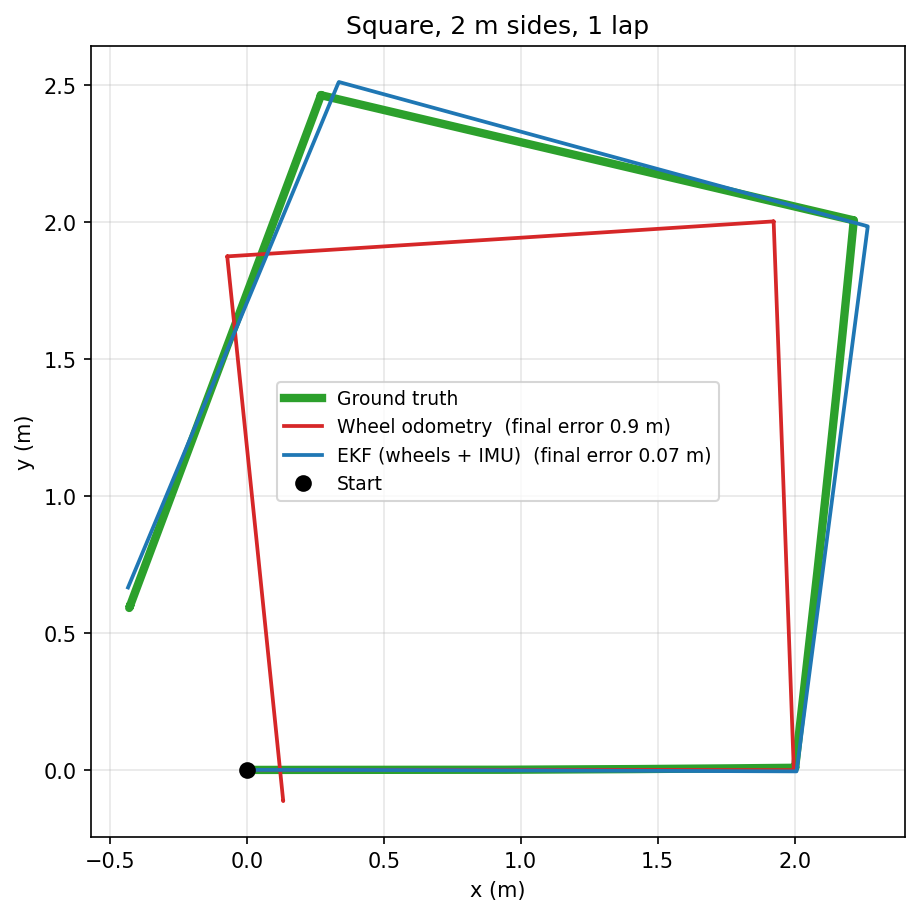
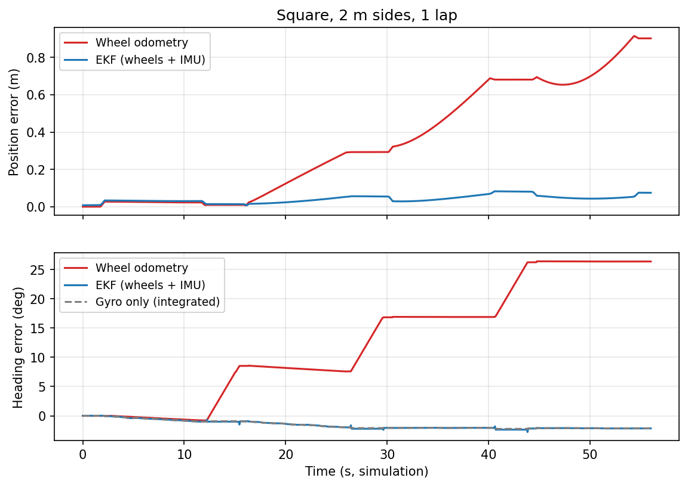

# Wheel Odometry + IMU Sensor Fusion with an EKF

A simulated differential-drive robot in Gazebo that fuses wheel odometry and gyroscope data using an Extended Kalman Filter (`robot_localization`). The fused estimate is evaluated against ground truth, tested under injected sensor faults, and tuned based on measured results.

Built with ROS 2 Humble, Gazebo Classic 11, `robot_localization`, Python



## Results Summary

- On a 2 m square, the EKF's final position error was 0.075 m, compared with 0.90 m for wheel odometry (drift 0.9% vs 11.2%).
- Outlier rejection removed the effect of gyro spikes, with no loss of accuracy in normal driving.
- Gyro dropouts first made the EKF worse than wheel odometry alone. Adding the wheels' turning rate as a backup brought the dropout error down from 0.83 m to 0.06 m.

## Approach

Wheel encoders measure distance accurately (0.2% error) but overcount rotation due to wheel slip (37% when turning in place). The gyroscope measures rotation directly and is unaffected by slip. The EKF is configured accordingly:

| Source | Used for | Reason |
|---|---|---|
| Wheels | Forward speed | Accurate to 0.2% |
| Gyro | Turning rate | Unaffected by wheel slip |
| Wheels | Turning rate (backup only) | Large covariance, so it only matters during gyro dropouts |
| IMU orientation | Not used | Gazebo reports a perfect orientation that a real 6-axis IMU couldn't provide |
| Accelerometer | Not used | A 0.1 m/s² bias adds up to about 5 m of error in 10 s |

One setting needed changing early on: by default, the Gazebo diff-drive plugin builds wheel odometry from the robot's true pose, so it never drifts. Setting `odometry_source: 0` makes it calculate odometry from wheel rotation instead.

All runs are driven by a scripted path driver, recorded with `ros2 bag`, and compared against Gazebo ground truth.

## Results

| Pattern | Source | Final error | Average error | Heading error |
|---|---|---|---|---|
| Square | Wheel odometry | 0.90 m | 0.45 m | 26° |
| Square | EKF | 0.075 m | 0.045 m | −2° |
| Circle (3 laps) | Wheel odometry | 0.66 m | 0.39 m | 102° |
| Circle (3 laps) | EKF | 0.28 m | 0.14 m | −31° |



Wheel odometry gains heading error at every corner, which then turns into position error on each following straight. The EKF's heading follows the gyro and stays within a few degrees. In continuous turning (the circle), the simulated gyro reads about 3% low. No other sensor measures heading reliably, so the EKF can't correct this.

## Fault Injection

A fault injector node between the sensors and the EKF simulates common sensor failures.

| Condition | EKF average error | Outcome |
|---|---|---|
| No fault | 0.06 m | Baseline |
| Wheel size 5% off | 0.14 m | Error passed through, since the wheels are the only forward-speed source |
| Wheel slip bursts | 0.67 m | Error passed through; outlier rejection barely helped |
| Gyro spikes | 0.50 m | Degraded |
| Gyro spikes + outlier rejection | 0.04 m | Spikes fully rejected |
| Gyro dropouts | 0.83 m | Worse than wheel odometry alone |
| Gyro dropouts + wheel backup | 0.06 m | Recovered |

Outlier rejection works well against brief glitches like spikes, but not against sustained faults like slip. Errors in something only one sensor measures, such as forward speed, can't be corrected by fusion. And with heading coming only from the gyro, a gyro dropout left the EKF predicting with a stale turning rate, so it missed turns entirely.

## Covariance Tuning

Using the wheels' turning rate as a backup required choosing its covariance:

| Wheel turning-rate σ | Normal driving error | Dropout error |
|---|---|---|
| Not fused | 0.05 m | 0.83 m |
| 0.05 rad/s (measured) | 0.10 m | 0.16 m |
| 0.2 rad/s (selected) | 0.02 m | 0.06 m |

The measured value of 0.05 rad/s fixed dropouts but doubled the error in normal driving, because the wheels' overcounting kept pulling the heading off even while the gyro was working. A larger value removed this pull while keeping the backup, since the filter's own uncertainty grows quickly once gyro data stops.

## Future Work

- Tune process noise so the EKF's reported uncertainty matches its actual error.
- Add a magnetometer as an absolute heading reference to correct gyro drift.
- Implement an EKF from scratch and compare it with `robot_localization` on the same recordings.

## Usage

```bash
# Build
cd ~/ekf_ws
colcon build --symlink-install
source install/setup.bash

# Run the simulation (optional fault: wheel_scale, wheel_slip, imu_spikes, imu_dropout)
ros2 launch diffbot_ekf sim.launch.py fault:=none

# In a second terminal: record, evaluate and compare runs
./tools/record_run.sh my_square -p pattern:=square
ros2 run diffbot_ekf evaluate runs/my_square --title "My square"
ros2 run diffbot_ekf compare
```

Requires Ubuntu 22.04, ROS 2 Humble, Gazebo Classic 11, `ros-humble-robot-localization`, `python3-numpy` and `python3-matplotlib`.
